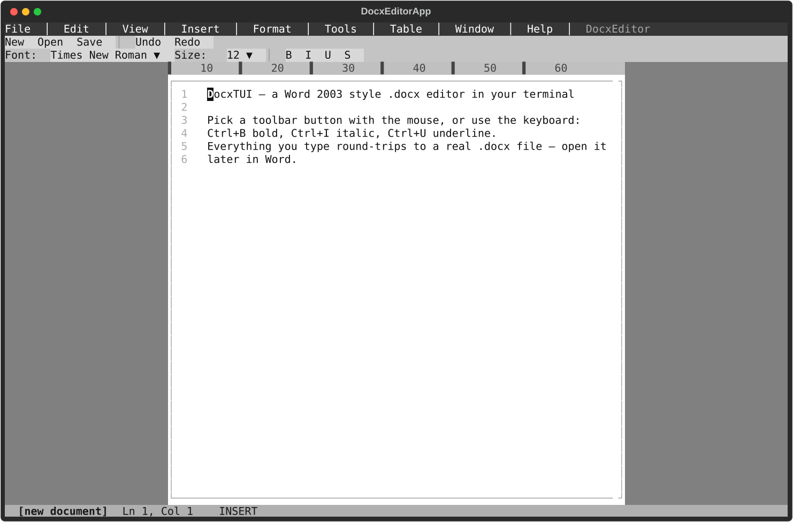

# DocxTUI

**Terminal-based .docx editor — Word 2003-style interface for your terminal.**

Edit Microsoft Word documents without leaving the command line. Full menu bar,
toolbars, page ruler, formatting controls, and native `.docx` round-trip.



---

## Quick Start

```bash
# Clone and set up
git clone <repo-url> && cd docx-tui
python3 -m venv .venv
.venv/bin/pip install textual python-docx

# Launch (blank document)
./run

# Open existing .docx file
./run document.docx
```

The `run` script and `main.py` automatically detect if `python-docx` is installed.
If missing, they re-execute with the project `.venv` automatically.

---

## Interface

The UI mimics Microsoft Word 2003:

```
┌─ Menu Bar ──────────────────────────────────────────────┐
│ File  Edit  View  Insert  Format  Tools  Table  Help    │
├─ Standard Toolbar ──────────────────────────────────────┤
│  New   Open   Save  │  Undo   Redo                      │
├─ Formatting Toolbar ────────────────────────────────────┤
│  Font: Times New Roman ▼  Size: 12 ▼ │  B   I   U   S  │
├─ Workspace (gray) ──────────────────────────────────────┤
│        ┌── Ruler ───────────────────────┐               │
│        │ 1▌ 2▌ 3▌ 4▌ 5▌ ...             │               │
│        │   1  Hello World                │               │
│        │   2                            │               │
│        └────────────────────────────────┘               │
├─ Status Bar ────────────────────────────────────────────┤
│  document.docx ●  Ln 1, Col 1  INSERT                   │
└─────────────────────────────────────────────────────────┘
```

**Key components:**

- **Menu Bar** — Word 2003-style dropdown menus (File, Edit, View, Insert, Format, Tools, Table, Window, Help) with keyboard shortcuts displayed
- **Standard Toolbar** — Quick-access buttons for New, Open, Save, Undo, Redo
- **Formatting Toolbar** — Font dropdown (12 fonts), font size dropdown (8–72 pt), and Bold/Italic/Underline/Strikethrough toggle buttons
- **Page Ruler** — Column measurement bar with tick marks every 5 and numbers every 10
- **Page Area** — White A4-like page on a gray workspace, with line numbers and soft word-wrap at 64 characters
- **Status Bar** — Shows filename, dirty indicator (●), line/column position, and mode

---

## Keyboard Shortcuts

| Shortcut | Action |
|----------|--------|
| `Ctrl+S` | Save |
| `Ctrl+O` | Open file |
| `Ctrl+Q` | Quit |
| `Ctrl+B` | Toggle bold |
| `Ctrl+I` | Toggle italic |
| `Ctrl+U` | Toggle underline |
| `Ctrl+Z` | Undo *(coming soon)* |
| `Ctrl+Y` | Redo *(coming soon)* |
| `Ctrl+A` | Select all *(coming soon)* |
| `Ctrl+F` | Find *(coming soon)* |
| `Ctrl+Home` | Go to document start |
| `Ctrl+End` | Go to document end |
| `F1` | Help |
| `Arrows` | Navigate cursor |
| `Home` / `End` | Line start / end |
| `Backspace` / `Delete` | Delete backwards / forwards |
| `Enter` | New line |
| `Esc` | Close menu / Quit |

Mouse is fully supported — click menu bar tabs, toolbar buttons, and dropdown items.

---

## Features

### Document editing
- Insert, delete, and navigate text with cursor
- Soft word-wrap at 64 characters with visual line numbers
- Paragraph splitting with Enter, merging with Backspace/Delete

### Formatting
- **Bold**, *Italic*, <u>Underline</u>, ~~Strikethrough~~ (toggle via toolbar or shortcuts)
- Font selection (12 common fonts: Times New Roman, Arial, Calibri, Courier New, etc.)
- Font size selection (8–72 pt)
- All formatting is saved to `.docx` and preserved when opened in Microsoft Word

### File operations
- Open existing `.docx` files (preserves all formatting, font name/size)
- Save via dialog with directory browser
- "Save As" support
- Dirty-document indicator (● in status bar)

### Word 2003 experience
- Dropdown menus with hover highlighting
- Toolbar buttons with click feedback
- Font/size picker dropdowns
- White page on gray workspace
- Column ruler aligned with page content

### Chinese input
- IME cursor position reporting for correct candidate window placement

---

## Project Structure

```
docx-tui/
├── main.py              # Entry point — auto-bootstrap with .venv
├── run                  # Launch script
└── src/
    ├── app.py           # Main app, screens (Save, Open, ForceQuit, Help, About)
    ├── toolbar.py       # MenuBar, DropdownWidget, PickerDropdown, toolbars
    ├── page.py          # PageView (white page), HorizontalRuler
    ├── editor.py        # Editor — cursor, insert/delete, formatting operations
    ├── model.py         # Document → Paragraph → Run data model
    └── docx_io.py       # .docx read/write via python-docx
```

---

## Dependencies

- **Python** ≥ 3.10
- **[Textual](https://github.com/Textualize/textual)** — TUI framework
- **[python-docx](https://python-docx.readthedocs.io/)** — .docx file format

Pinned versions live in [`requirements.txt`](requirements.txt) — install with:

```bash
python3 -m venv .venv && .venv/bin/pip install -r requirements.txt
```

(or `uv run main.py`, uv reads the same file)

---

## Running Tests

```bash
.venv/bin/python tests/test_smoke.py     # Editor insert + .docx round-trip
.venv/bin/python tests/test_format.py    # Bold / italic / underline round-trip
.venv/bin/python tests/test_font.py      # Font name / size round-trip
```

---

## Known Limitations

- **Terminal monospace** — Font family and size changes are stored in the `.docx` metadata. They are visible when the file is opened in Word, but not rendered differently in the terminal (terminals use a single monospace font).
- **No rich-text rendering in page** — Bold, italic, etc. are stored correctly but the current page renderer shows plain text with line numbers. Formatted rendering is planned.
- **No clipboard support** — Cut/Copy/Paste are not yet implemented.
- **No undo/redo** — Planned for a future release.
- **Mouse required for toolbars** — Toolbar buttons currently require mouse clicks (keyboard shortcuts cover the same actions).

---

## License

MIT
